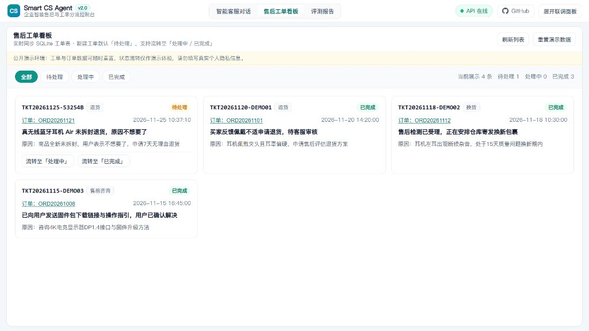

# Smart CS Agent v2.0 - 企业智能售后与工单分流 Agent

<p align="center">
  <b>面向真实电商售后与工单流转场景的生产级智能客服系统</b><br>
  SSE 事务事件流 · 证据账本硬校验 · 高风险写操作 HITL · Hybrid RAG + Pre-RRF 双路门控
</p>

<p align="center">
  
  
  
  
  
  
</p>

<p align="center">
  🌐 <a href="http://8.166.124.35:8000/"><b>在线体验工作台</b></a> ·
  📊 <a href="http://8.166.124.35:8000/#eval"><b>在线评测报告页（实时读取 eval_summary.json）</b></a> ·
  📖 <a href="http://8.166.124.35:8000/docs"><b>Swagger API 文档</b></a>
</p>

---

## 🖼️ 系统核心界面实拍

| 智能对话工作台 + Hybrid RAG 联调面板 | HITL 高风险建单人工确认 + 双路融合溯源 |
| :---: | :---: |
|  |  |
| **售后工单看板（严格单向状态机）** | **在线量化评测报告（4 组消融对比 + 失败归因）** |
|  |  |

---

## 📊 核心评测结果速览（第一屏指标）

> 所有指标均由 [`eval/run_rag_eval.py`](eval/run_rag_eval.py) 自动输出至 [`eval/eval_summary.json`](eval/eval_summary.json) 并由网站「[评测报告](http://8.166.124.35:8000/#eval)」标签页实时渲染，与完整报告 [`eval/rag_eval_report.md`](eval/rag_eval_report.md) 严格同源。

### 1. 四种检索配置量化对比（40 题真实 `BAAI/bge-m3` 冷查询实测）

| 检索配置 | Hit@3（30题） | 书面 Hit@3 | 口语 Hit@3 | MRR | Precision@3 | 域外误召回率 FPR（10题） | 平均 / P95 耗时 (ms) |
| :--- | :---: | :---: | :---: | :---: | :---: | :---: | :---: |
| **1. 纯 BM25** | 56.7% | 100.0% | 13.3% | 0.5278 | 40.6% | 10.0% (1/10) | 0.4 / 0.5 |
| **2. 纯向量 (Vector Only)** | 100.0% | 100.0% | 100.0% | 0.9833 | 46.7% | 100.0% (10/10) | 128.0 / 174.5 |
| **3. Hybrid 无门控** | 96.7% | 100.0% | 93.3% | 0.8833 | 42.2% | 100.0% (10/10) | 137.0 / 213.0 |
| **4. Hybrid + Pre-RRF 双路门控**（生产默认） | **100.0%** | **100.0%** | **100.0%** | **0.9833** | **72.8%** | **10.0% (1/10)** | **138.6 / 213.0** |

### 2. 端到端 100 题并发业务评测核心指标

| 总体通过率 (Pass Rate) | 工具路由准确率 (Tool Accuracy) | 防幻觉安全率 (Safety Rate) | 平均 / P95 端到端耗时 | 在线评测明细 |
| :---: | :---: | :---: | :---: | :---: |
| **90.0%** (90/100) | **94.0%** (94/100) | **97.0%** (97/100) | **1763 / 2873 ms** | 👉 [查看在线评测报告](http://8.166.124.35:8000/#eval) |

> **关键结论**：相比纯 BM25，Hybrid + Pre-RRF 将口语化 Hit@3 从 **13.3% 提升至 100.0%**；相比无门控 Hybrid，将 **Precision@3 从 42.2% 提升至 72.8%（+30.6pp）**、域外误召回率从 **100.0% 降至 10.0%（-90.0pp）**；生产环境开启 256 容量 Query Embedding LRU 缓存后，高频问法耗时可降至 **~4.6 ms**。

---

## 📌 项目定位与 v2.0 演进

`smart-cs-agent` 是一套面向电商平台与企业客服真实业务场景的**生产级轻量智能售后 Agent**。v2.0 在保持轻量、透明、可逐行审计的基础上，围绕**可靠性、可观测性与检索精度**完成全面升级：

- **可恢复 SSE 事务事件流**：基于 SQLite 事务日志（`chat_turns` / `chat_events`）先落库分配严格递增 `seq` 再推流；前端维护 `turn_id + lastSeq + processedSeqs` 幂等去重，流中断后自动通过 `GET /api/chat/turns/{turn_id}/events?after_seq=...` 无缝补发。
- **证据账本与代码级防幻觉护栏**：`LangGraph StateGraph` 显式编排 `agent → tools → policy_verifier → fallback` 闭环；工具执行结果写入 `EvidenceLedger`，由规则校验器硬拦截“未查单编造物流状态”或“未调用工具谎称已建单”，超限或超时安全降级。
- **高风险写操作 HITL 人工确认**：流式模式下触发 `create_after_sales_ticket` 时自动挂起落库、推送 `approval_required` 事件并在对话流中渲染授权卡片，由用户显式点击「确认建单 / 取消建单」调用 `POST /api/chat/turns/{turn_id}/approve` 续流收尾。
- **Hybrid RAG + Pre-RRF 双路原生门控**：融合 `jieba + rank-bm25` 词法检索与 `BAAI/bge-m3 + Chroma` 本地持久化语义检索，经 Pre-RRF 双路原生相关性门控与 RRF（$k=60$）单路尾部裁剪，在 40 题实测中实现 **100% Hit@3、0.9833 MRR、72.8% Precision@3、10% 域外误召回率**；无 Key 或在线超时自动降级纯 BM25，并配备进程级启动预热 + 256 容量 Query Embedding LRU 缓存（缓存命中耗时 ~4.6 ms）。
- **React + TypeScript + Vite 控制台**：集成智能客服流式工作台、严格单向状态机工单看板（`待处理 → 处理中 → 已完成`，终态禁逆转）以及订单与 Hybrid RAG 实时联调面板。

---

## 🏗️ v2.0 系统架构

```text
           +-------------------------------------------------------------------+
           |        Frontend Console (React 19 + TypeScript + Vite)            |
           |  ChatWorkspace (SSE+seq去重) | TicketBoard | InspectorDrawer      |
           +---------------------------------+---------------------------------+
                                             | HTTP / SSE (/api/*)
                                             v
+---------------------------------------------------------------------------------------------+
|                             FastAPI Gateway & Demo Guardrails                               |
|  - 对话滑动窗口限流 (RATE_LIMIT_PER_MINUTE) + 每日全局熔断 (DAILY_CHAT_LIMIT)                 |
|  - 业务接口分桶 IP 限流 (读 60/min, 写 20/min) + 重置双层保护 (DEMO_ADMIN_TOKEN / 5min冷却)   |
|  POST /api/chat/stream | GET /turns/{id}/events | POST /turns/{id}/approve | /orders|/tickets|
+--------------------------------------------+------------------------------------------------+
                                             |
                                             v
+---------------------------------------------------------------------------------------------+
|                       LangGraph StateGraph + Transactional Event Store                      |
|                                                                                             |
|   START -> agent --(tool_calls)--> tools --(高风险写操作 HITL 挂起)--> approval_required     |
|              |                       |                                    | (/approve)      |
|              |                       +--> 更新 EvidenceLedger + 派发 citation_details        |
|              v                                                                              |
|        policy_verifier --(pass)--> END (done 落库)                                          |
|              |--(fail & retry<=2)--> agent 重写                                             |
|              +--(fail>2 / 超时 / 步数耗尽)--> fallback -> END                               |
+--------------------------------------------+------------------------------------------------+
                                             |
                   +-------------------------+-------------------------+
                   |                                                   |
                   v                                                   v
   +------------------------------------------+      +----------------------------------------+
   |       Hybrid RAG Engine (低内存无Torch)   |      |        SQLite Native Storage (WAL)     |
   | - 词法路: jieba + BM25 (绝对+0.5相对门控) |      | - orders (24条标准覆盖全周期种子单)     |
   | - 语义路: bge-m3 + Chroma 持久化 (指纹复用)|      | - tickets (严格单向状态机)              |
   |   (余弦>=0.58 + Top1落差<=0.10 + LRU缓存) |      | - chat_logs (最近6轮会话记忆)           |
   | - 融合层: RRF (k=60) + 单路尾部裁剪 (0.6) |      | - chat_turns / chat_events / approvals |
   +------------------------------------------+      +----------------------------------------+
```

---

## 🛠️ 技术栈选型

| 模块 | 技术选型 | 说明 |
| :--- | :--- | :--- |
| **后端服务** | Python 3.12 · FastAPI · Pydantic v2 · Uvicorn | 全异步接口、严格 Schema 校验与 Swagger 文档 |
| **状态编排** | LangGraph (`StateGraph`) | 显式节点与护栏流转，不引入重型链式黑盒封装 |
| **大模型适配** | 官方 `openai` SDK（端口-适配器模式） | 支持 DeepSeek / 通义 / 豆包等 OpenAI 兼容协议热切换 |
| **混合检索** | `jieba` + `rank-bm25` + `chromadb` + 在线 Embedding | 零 `torch` / 本地大模型依赖，低内存容器友好，无 Key 自动降级 BM25 |
| **数据存储** | Python 标准库 `sqlite3`（WAL 模式 + 参数化 SQL） | 零 ORM 黑盒，事务保证事件 `seq` 严格递增与工单一致性 |
| **前端控制台** | React 19 · TypeScript · Vite 6 | 仅 7 个核心依赖，自定义 SSE 帧解析与 `seq` 幂等补发状态机 |
| **容器部署** | Multi-Stage Docker (`node:20-alpine` + `python:3.12-slim`) | 单容器托管前后端，挂载 `./data` 持久化 SQLite 与 Chroma 索引 |

---

## ⚡ 本地运行、容器部署与评测复现

### 1. 环境准备

```bash
git clone https://github.com/chenhuaihao/smart-cs-agent.git
cd smart-cs-agent

# 创建 Python 3.12 虚拟环境并安装依赖
python -m venv .venv
# Windows (PowerShell)
.venv\Scripts\Activate.ps1
# Linux / macOS
source .venv/bin/activate

pip install -r requirements.txt

# 复制环境变量模板并填入真实 API Key（EMBEDDING_API_KEY 可选，留空自动降级纯 BM25）
cp .env.example .env
```

### 2. 前后端本地启动

**方式 A：开发热更新联调（推荐）**
```bash
# 终端 1：启动 FastAPI 后端（端口 8000）
uvicorn app.main:app --host 127.0.0.1 --port 8000 --reload

# 终端 2：安装并启动 React + Vite 前端（端口 5173，/api 自动代理至 8000 且不缓冲 SSE）
cd frontend
npm install
npm run dev
```
打开浏览器访问 **http://127.0.0.1:5173/**（Swagger 文档：http://127.0.0.1:8000/docs）。

**方式 B：单端口生产预览**
```bash
cd frontend && npm install && npm run build && cd ..
uvicorn app.main:app --host 127.0.0.1 --port 8000
```
直接访问 **http://127.0.0.1:8000/** 即可使用编译后的 v2.0 控制台。

### 3. Docker 多阶段一键部署

```bash
# 确保项目根目录已配置 .env
docker compose up -d --build

# 查看容器状态与健康检查
docker compose ps
docker compose logs -f smart-cs-agent
```
容器默认通过 `./data:/app/data` 挂载持久化 SQLite（`smart_cs.db`）与 Chroma 向量库（`chroma_db/`）。

### 4. 单元测试与评测复现

```bash
# 1. 运行全量后端单元测试（P0 流式与补发 + P1 护栏与 HITL + P2/P4 Hybrid RAG 与限流，零外网依赖）
pytest tests/ -v

# 2. 运行前端类型检查与生产构建
cd frontend && npx tsc --noEmit && npm run build

# 3. 复现 40 题 4 配置 RAG 量化评测（需 .env 已配置 EMBEDDING_API_KEY）
python eval/run_rag_eval.py

# 4. 复现 100 题端到端对话并发评测（需服务已启动）
RATE_LIMIT_PER_MINUTE=1000 python eval/run_eval.py --workers 4
```

---

## 📂 目录结构

```text
smart-cs-agent/
├── app/
│   ├── main.py                   # FastAPI 入口、启动预热与 frontend/dist 自动托管
│   ├── agent/
│   │   ├── core.py               # 流式调度、整轮超时与 HITL 挂起/恢复
│   │   ├── graph.py              # LangGraph 状态机（agent / tools / policy_verifier / fallback）
│   │   ├── guardrails.py         # EvidenceLedger 证据账本与代码级规则校验器
│   │   ├── knowledge.py          # Hybrid RAG（BM25 + 向量 + Pre-RRF 门控 + RRF 裁剪 + LRU 缓存）
│   │   ├── vector_store.py       # Chroma 本地持久化封装与内容哈希增量同步
│   │   ├── tools.py              # 4 个业务工具定义与安全分发器
│   │   ├── memory.py             # 会话最近 6 轮上下文读写
│   │   └── prompts.py            # 系统指令与业务守则
│   ├── llm/
│   │   ├── base.py               # BaseLLMProvider 抽象端口
│   │   ├── deepseek.py           # OpenAI 兼容流式 Provider 适配器
│   │   ├── factory.py            # LLM Provider 单例工厂
│   │   └── embedding.py          # BaseEmbeddingProvider + OpenAI 兼容在线 Embedding 适配器
│   ├── core/limiter.py           # 滑动窗口 IP 限流、每日熔断与重置冷却/口令保护
│   ├── db/                       # SQLite DDL、事务事件存储（events.py）与 24 条标准种子数据（seed.py）
│   ├── routers/                  # /api/chat、/api/orders、/api/tickets、/api/knowledge
│   └── schemas/                  # Pydantic v2 契约模型
├── frontend/                     # React 19 + TypeScript + Vite 6 控制台工程
│   ├── vite.config.ts            # /api 代理与 SSE 透传配置
│   └── src/
│       ├── types/chat.ts         # 与后端对齐的完整 TypeScript 协议类型
│       ├── api/client.ts         # REST + ReadableStream SSE 解析客户端
│       ├── hooks/useChatStream.ts# 流式状态机、after_seq 自动补发与 seq 幂等去重
│       └── components/           # ChatWorkspace / ApprovalCard / TicketBoard / InspectorDrawer / FormattedText
├── data/knowledge/               # 6 篇售后规则与故障排查 Markdown 知识库
├── eval/                         # 100 题端到端评测 + 40 题 4 配置 RAG 消融评测套件
├── tests/                        # P0 / P1 / P2 / P4 自动化验收测试套件（19 条用例）
├── Dockerfile                    # Node 20 + Python 3.12 多阶段轻量构建
├── docker-compose.yml            # 单容器编排与数据卷持久化
└── .env.example                  # 全量环境变量模板
```

---

## 🌐 公网演示环境与开源协议

- **公网演示地址**：http://8.166.124.35:8000（阿里云 ECS 华南 3·广州，Docker Compose 单容器部署，启用 IP 限流与每日配额保护）
- **开源协议**：本项目基于 [MIT License](LICENSE) 开源。
