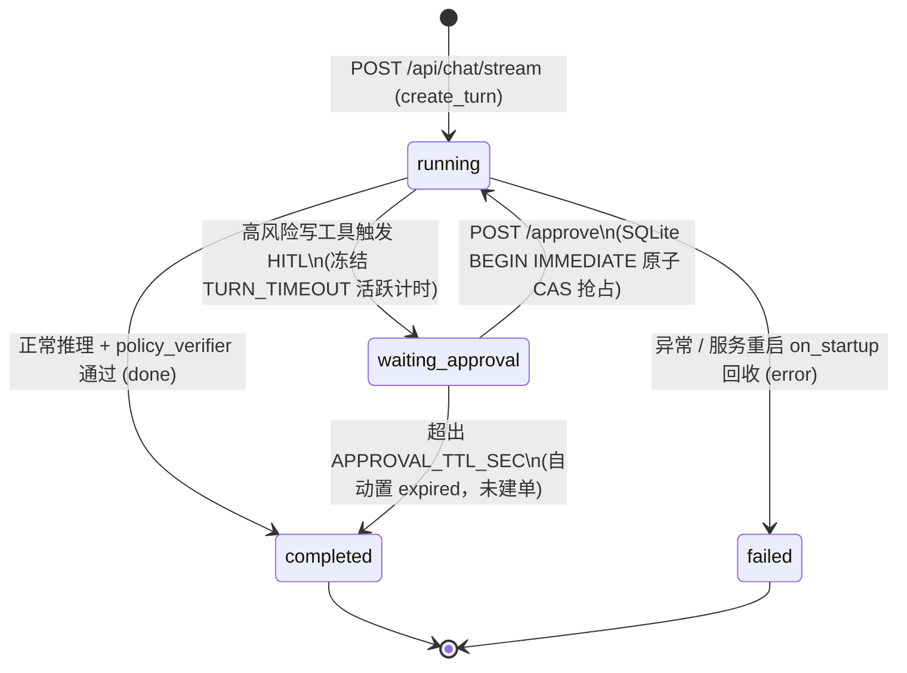

# Smart CS Agent v3.0 架构设计、权衡决策（ADR）与排障复盘

本文档记录 `smart-cs-agent` 从 v1.0 到 v3.0 演进过程中的核心架构决策、状态机边界设计以及真实排障沉淀，帮助快速理解“为什么这么设计”而非仅仅“用了什么框架”。

---

## 一、核心架构决策记录（ADR）

### ADR-1：为什么用 SQLite WAL + 事务事件表，而不是引入 Redis / Kafka？
- **上下文**：需要支持 SSE 实时流式输出、断线按 `after_seq` 精确补发、以及 HITL 高风险建单跨重启持久化恢复，同时目标部署在 2GB 内存的单台轻量云主机。
- **决策**：采用 Python 标准库 `sqlite3`（开启 `PRAGMA journal_mode=WAL` 与 `busy_timeout=15000`），通过 `BEGIN IMMEDIATE` 写事务 + `UNIQUE(turn_id, seq)` 约束保证事件先落库拿严格递增 `seq` 再推送。
- **权衡与演进**：单机部署零外部中间件、零运维成本、读补发不阻塞写事件；若未来演进为多副本水平扩展，仅需将 `app/db/events.py` 替换为 PostgreSQL + Redis Pub/Sub（保持 `ChatEvent` 契约与 `after_seq` 协议不变）。

### ADR-2：为什么选在线 Embedding（`BAAI/bge-m3`）+ 本地 Chroma，而不是本地部署 `torch`？
- **上下文**：在 2GB 内存单容器下引入 `torch + sentence-transformers` 会导致镜像膨胀至 2GB+ 且极易 OOM；但纯 BM25 在口语化问法上召回率仅 13.3%。
- **决策**：保持端口-适配器模式（`BaseEmbeddingProvider`），接入在线 OpenAI 兼容 Embedding API，将 45 块知识向量持久化至 `./data/chroma_db` 并以 `index_manifest.json`（文档内容 SHA-256 + 模型名）做指纹复用；叠加 256 容量 Query Embedding LRU 缓存与无 Key/超时自动降级纯 BM25。
- **实测收益**：冷启动容器内存仅 ~300MB，口语化 Hit@3 从 **13.3% 提升至 100.0%**，高频查询命中 LRU 缓存耗时降至 **~4.6ms**。

### ADR-3：为什么采用「输入前置拦截 + 证据账本代码级硬校验」，而不是同步 LLM-as-a-Judge？
- **上下文**：在线客服对首字延迟（TTFT）与单轮成本极其敏感；同步引入第二轮裁判模型会直接让延迟翻倍、token 翻倍，且裁判模型本身同样存在幻觉概率。
- **决策**：双层确定性护栏：
  1. **输入前置护栏（0ms）**：在进入 LLM 前拦截高置信度 Prompt Injection（规则覆盖、系统提示词窃取、管理员身份伪造、破坏性 SQL 注入），零 token 浪费且对正常售后零误杀；
  2. **输出证据账本硬校验（`EvidenceLedger`）**：工具执行结果结构化写入账本，对高置信结构化幻觉（未查订单号、未核实运单号、未建单却声称已建单、暴露内部 `.md` 路径）输出结构化违规码（`UNVERIFIED_ORDER` / `FAKE_TICKET_CREATION` / `INTERNAL_PATH_LEAK` 等），触发最多 2 次重写，超限转入 `fallback_node`。
- **边界坦诚与演进**：确定性规则擅长守住结构化事实红线，无法覆盖隐晦语义偏移；后续若进入高客单价企业生产环境，可在离线链路增加**异步 LLM-as-a-Judge 抽检**做质量巡检，兼顾在线低延迟与离线语义覆盖。

### ADR-4：单机内存限流器的边界与多实例演进
- **当前实现**：`app/core/limiter.py` 纯标准库实现线程安全滑动时间窗口（单 IP 频控）+ 北京时间自然日全局熔断（`DAILY_CHAT_LIMIT`）+ 演示重置双层保护（口令 / 冷却），零依赖且支持反向代理 `X-Forwarded-For` 解析。
- **多实例演进**：多节点部署时可将 `SlidingWindowLimiter` 与 `DailyQuotaLimiter` 替换为 Redis ZSET Lua 脚本实现集群共享配额，路由层 `Depends(...)` 签名无需任何改动。

---

## 二、HITL 生命周期与运行态收敛状态机（v3.0 P1）

核心可靠性设计：
1. **活跃预算与人工等待解耦**（`app/agent/run_guard.py`）：`await_with_active_budget` 在 `waiting_approval=True` 时冻结 `TURN_TIMEOUT_SEC`（45s）计时，人工确认改由独立的 `APPROVAL_TTL_SEC`（默认 300s）守护；
2. **并发双击原子 CAS 防重**（`app/routers/chat.py` + `app/db/events.py`）：在发送 HTTP 200 SSE 响应头**之前**，先通过 SQLite `BEGIN IMMEDIATE` 原子校验并抢占 `waiting_approval` 状态，保证并发双击严格仅 1 次 `200` 创建 1 张工单，其余重复请求一律返回 `409 Conflict`；
3. **跨进程重启与看门狗僵尸回收**：FastAPI `lifespan` 启动时立即执行 `reap_stale_turns_now(on_startup=True)` 回收进程异常退出遗留的僵尸 `running` 轮次，后台周期巡检自动收敛过期审批并唤醒释放内存 `_approval_waiters`，杜绝内存与状态泄漏。

---

## 三、真实排障与迭代复盘（踩过的 5 个生产坑）

1. **DeepSeek 多步工具调用前偶发吐英文旁白并黏在 HITL 卡片上方（commit `7ea69f3`）**
   - **现象**：模型在调用 `query_order` / `create_after_sales_ticket` 前输出 `"I'll help you create a return ticket..."`，实时推流导致 3 句英文旁白无空格粘连在 HITL 授权卡片上方。
   - **根因**：后端为保障 TTFT 实时透传所有 `text_delta`；正常轮次由终态 `done` 覆盖，但 HITL 挂起时 `done` 尚未到达。
   - **修复**：System Prompt 强化中文与禁前导旁白约束 + 前端纯函数归约器 `streamReducer.ts` 在收到 `tool_running` / `approval_required` 时清空工具前过渡草稿（零 TTFT 损耗）。

2. **v2.0 隐藏并发 Bug：`TURN_TIMEOUT_SEC` 45s 误杀 HITL 人工确认等待（v3.0 P1 修复）**
   - **现象**：`asyncio.wait_for(_consume_graph_events(...), timeout=45)` 直接包裹了 `_approval_handler` 的人工等待，用户思考超过 45 秒点确认会被误杀降级且导致两表状态撕裂。
   - **修复**：引入 `await_with_active_budget` 冻结 HITL 挂起期间的活跃计时，由独立 `APPROVAL_TTL_SEC`（300s）与 `RunGuardWatchdog` 统一收敛。

3. **v2.0 隐藏竞态：`/approve` 路由先读状态再开 SSE 流存在 TOCTOU 双击窗口（v3.0 P1 修复）**
   - **现象**：两个并发 `/approve` 同时通过非原子 `get_turn` 校验后均返回 `200 OK`，第二个请求在流生成器内部抛 `ValueError` 导致流异常断开。
   - **修复**：将 `resolve_pending_approval` 的 SQLite `BEGIN IMMEDIATE` 原子 CAS 前移至构建 `StreamingResponse` 之前，5 线程并发实测严格 1 次 200 + 4 次 409 + 仅 1 张工单。

4. **Hybrid RAG 无门控导致域外误召回率高达 100%（v2.0 P4-A/B 修复）**
   - **现象**：RRF 只看排名不看原始相似度，纯向量对域外问题（如“会员积分换现金”）仍强行返回 Top-K，导致 Precision@3 跌至 42.2%、域外 FPR 高达 100%。
   - **修复**：在 RRF 之前增加 Pre-RRF 双路原生门控（BM25 绝对/相对阈值 + 向量余弦 ≥ 0.58 & Top-1 落差 ≤ 0.10）及 RRF 单路尾部裁剪，Precision@3 提升 **+30.6pp（→72.8%）**，FPR 骤降 **-90.0pp（→10.0%）**。

5. **自动化评测脚本静态黑名单误伤否定句（v3.0 P4 修复）**
   - **现象**：回复“该商品**不支持**7天无理由退货”或“关于**是否**支持24期免息”被 `kw in reply` 静态子串匹配误判为违规词命中（假阴性）。
   - **修复**：在 `eval/run_eval.py` 引入否定/疑问窗口感知匹配 `_is_affirmative_forbidden_hit`，区分真实肯定违规与合规否定解释。
